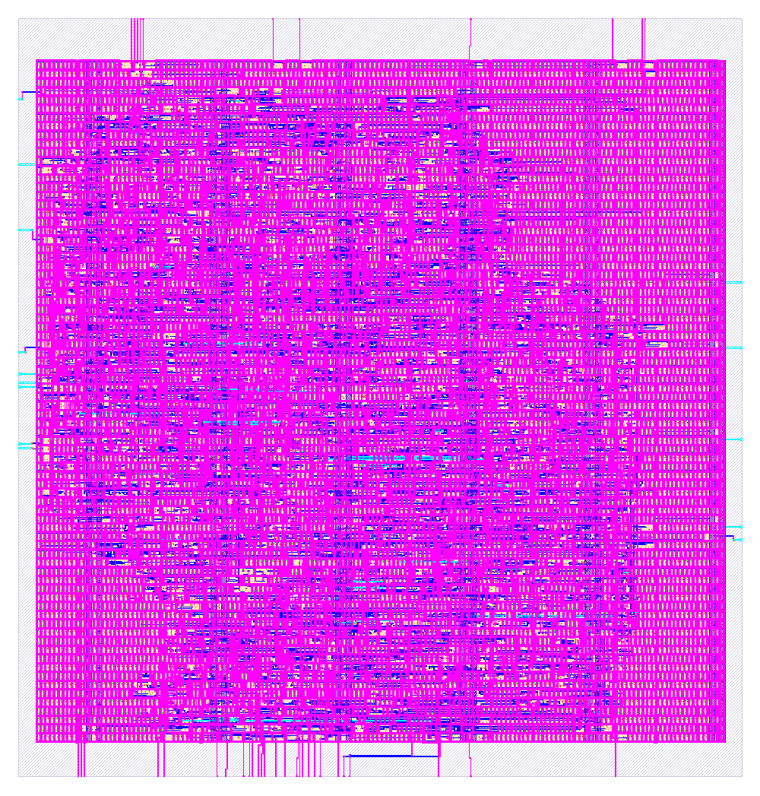
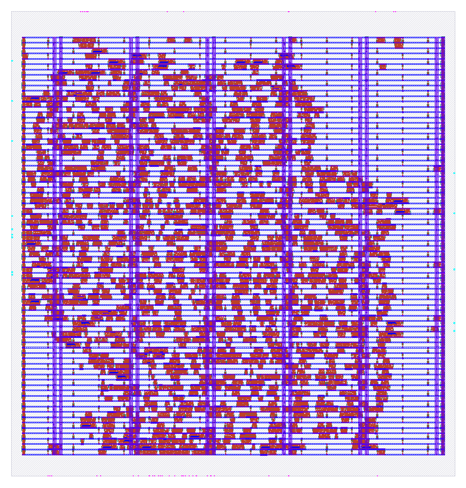
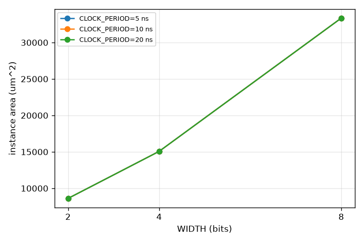
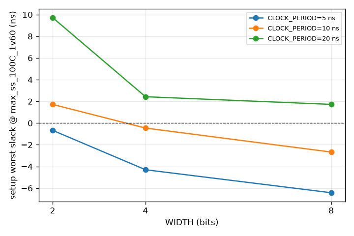
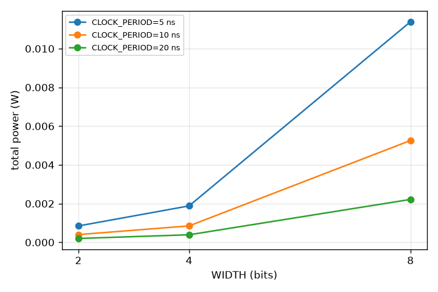

# spec2tapeout

An open-source RTL-to-GDS "factory" for a parameterized signed int8 multiply-accumulate (MAC) on the
SkyWater sky130A process. One `make` ladder takes the Verilog from lint, through golden-vector
simulation, Yosys synthesis, the full LibreLane / OpenROAD place-and-route flow, nine-corner signoff
timing, DRC, LVS and XOR, to a gate-level simulation of the final netlist and a Tiny Tapeout submission
bundle. A Python orchestrator closes timing on its own from a fixed rule table and writes every decision,
with before/after metrics, into a ledger. Everything the reports claim points at a file on disk.

<p align="center">
  
  
</p>
<p align="center"><sub>Left: final GDS of <code>mac_int8</code> (sky130A, 225.6 x 236.3 um die). Right: the same run after clock-tree synthesis, rendered by KLayout from the OpenROAD database.</sub></p>

## Headline results

| item | value | where it comes from |
|---|---|---|
| Design | `mac_int8`, WIDTH 8, ACC_WIDTH 32, signed 8x8 multiply + 32-bit accumulate | `rtl/mac_int8.v` |
| Closed clock | **16.1 ns (62.1 MHz)** at the slow corner; the 10 ns target did not close (see below) | `runs/*/final/metrics.json` |
| Setup / hold slack | +0.571 ns setup (max_ss_100C_1v60), +0.112 ns hold (min_ff_n40C_1v95), 0 violations on all 9 corners | `55-openroad-stapostpnr/summary.rpt` |
| Area | die 53,291 um², 2,234 standard cells (16,053 um²), 35.3 % utilization | metrics.json |
| Power | 1.655 mW total (0.716 internal, 0.939 switching, 45 nW leakage) | OpenSTA `power.rpt` |
| Signoff | Magic DRC 0, KLayout DRC 0, Netgen LVS 0, GDS XOR 0, antenna 0, route DRC 0 | metrics.json |
| Timing closure | 15 hardens, 14 recorded decisions, one regression branch detected and abandoned | `factory/state/decisions.json` |
| Verification | 5,651 golden vectors frozen before the RTL was written; RTL and post-layout gate-level netlists pass them all | `tests/golden/`, `logs/gates/` |
| Sweep | WIDTH {2,4,8} x CLOCK_PERIOD {5,10,20} ns, 9/9 runs with metrics, 4 close timing | `factory/state/sweep.csv` |
| Tiny Tapeout | 2x2 output-stationary MAC array, 2x2 tile, 4,189 cells, precheck 15/15, gate-level test pass | `flow/tt/`, `factory/state/tt_metrics.json` |

Full detail, with every number sourced: [`reports/MORNING_REPORT.md`](reports/MORNING_REPORT.md).
Open items that still need a person: [`NEEDS_HUMAN.md`](NEEDS_HUMAN.md).

## How the pipeline is built

The whole thing is a Makefile gate ladder. Each target is a *gate*: it runs one command through
`factory/gate.py`, which streams the output to `logs/gates/<gate>.log`, records the real exit code,
start/end time and duration into `factory/state/gates.json`, and appends a line to `logs/overnight.md`.
Nothing is marked passed by hand. If the command did not exit 0, the gate failed.

```
doctor -> lint -> gen-golden -> freeze-golden -> sim -> synth -> harden / harden-closure
       -> sta-report -> sim-gl -> render -> sweep -> dashboard
       -> tt-harden -> tt-test -> tt-test-gl -> precheck -> verify-factory -> report
```

### Stage by stage: what tool runs and what connects it to the next stage

**1. `make doctor`** (`factory/doctor.sh`). Prints the version of every tool the ladder needs and exits
nonzero if one is missing. It checks the host tools (Python venv, cocotb, ciel, Yosys, Verilator, Icarus,
jq, gh, Nix) and then enters the LibreLane Nix shell to check the flow tools (LibreLane, OpenROAD, KLayout,
Magic, Netgen, Yosys) plus the three PDK files the gate-level simulation and the flow depend on.

**2. `make lint`** (`factory/lint.sh`). Verilator `--lint-only --Wall` on all three tops
(`mac_int8`, `mac_array_2x2`, `tt_um_noahsabb_mac`). A fixed list of warning classes is fatal
(LATCH, MULTIDRIVEN, CASEINCOMPLETE, UNDRIVEN, IMPLICIT, BLKSEQ, COMBDLY, ...); width warnings are
printed for review but do not fail the gate.

**3. Reference model and golden vectors** (`ref/mac_ref.py`, `ref/gen_golden.py`, `tests/golden/*.json`).
A plain-Python model of the MAC, the 2x2 array and the Tiny Tapeout byte-serial protocol is the single
source of truth. `make gen-golden` drives it with directed sign-corner cases followed by seeded random
traffic (15 % idle cycles, 1 % resets, 3 % clears) and writes 5,651 input/expected-output vectors into six
JSON files. `make freeze-golden` then makes `ref/` and `tests/golden/` read-only (`chmod a-w`), adds them to
a protected-path list enforced by a pre-tool hook, and commits. The RTL was written *after* this commit,
so the tests could never be bent toward the implementation.

**4. `make sim`** (`tests/Makefile`, `tests/test_*.py`). cocotb 2.1 on Icarus Verilog 13. The Verilog
testbench (`tests/tb_mac.v`) is parameterized with `-P` so the same RTL is simulated at WIDTH 2/4/8; the
cocotb test replays the matching golden file cycle by cycle and also runs a seeded randomized test against
the live Python model. `cocotb_tools.check_results` turns the `results.xml` into the gate's exit code.

**5. `make synth`** (`factory/synth_check.py`). A fast standalone Yosys run, independent of LibreLane,
that reads the sky130 liberty, synthesizes each top with `synth -flatten`, maps flops with `dfflibmap`
and logic with `abc -liberty`, and fails on any `$`-prefixed unmapped cell, inferred latch, `$mem`, or
`check -mapped` warning. It is the five-second sanity check before a two-minute harden.

**6. `make harden TAG=<tag>`**. The full LibreLane 3.0.16 *Classic* flow (75 step directories) run
natively inside `nix-shell ~/librelane/shell.nix`. The config is a plain JSON file
(`flow/mac_int8/config.json`) with every `RUN_*` stage switched on and every `ERROR_ON_*` checker set to
fail the run. Inside the flow, in order:

| LibreLane step group | tool | what it does |
|---|---|---|
| Verilator.Lint | Verilator | second lint, with PDK models excluded |
| Yosys.Synthesis + Checker.* | Yosys 0.62 + ABC | flatten, map to `sky130_fd_sc_hd`, `SYNTH_STRATEGY` picks the ABC script |
| OpenROAD.STAPrePNR | OpenSTA | ideal-clock timing of the mapped netlist |
| OpenROAD.Floorplan, TapEndcap, GeneratePDN, IOPlacement | OpenROAD ifp / tap / pdngen / ppl | die from `FP_CORE_UTIL`, tap cells every 13 um, met1 rails + met4 straps, pins on the die edge |
| OpenROAD.GlobalPlacement, RepairDesignPostGPL, DetailedPlacement | OpenROAD gpl (RePlAce) / rsz / dpl | timing- and routability-driven placement, slew/cap/fanout repair, legalization |
| OpenROAD.CTS, ResizerTimingPostCTS | TritonCTS / rsz | clock tree, then setup repair followed by hold repair with buffers |
| OpenROAD.GlobalRouting, RepairAntennas, DetailedRouting | FastRoute / TritonRoute | routing up to met4, antenna diodes, 64 DRC-driven iterations |
| OpenROAD.FillInsertion, RCX | OpenROAD / OpenRCX | fill/decap cells, parasitic extraction per corner |
| OpenROAD.STAPostPNR | OpenSTA | **the only timing that counts**: post-RCX, nine corners (ss/tt/ff x min/nom/max RC) |
| OpenROAD.IRDropReport | psm | static IR drop |
| Magic.StreamOut, KLayout.StreamOut, KLayout.XOR | Magic 8.3 / KLayout 0.30 | two independent GDS writers, XORed against each other |
| Magic.DRC, KLayout.DRC, Magic.SpiceExtraction, Netgen.LVS | Magic / KLayout / Netgen 1.5 | two DRC decks, extraction, layout-vs-schematic |
| Checker.SetupViolations, HoldViolations, MaxSlew, MaxCap, ... | LibreLane | each checker fails the flow on its metric |

`make harden` copies `rtl/*.v` into the flow's `src/` directory, runs the flow through `gate.py`, then
calls `factory/orchestrate.py ingest`, which is the glue between LibreLane and everything downstream.

**7. Ingest** (`factory/orchestrate.py ingest`). Walks `runs/<tag>/NN-<tool>-<step>/`, maps the 75 step
directories onto 22 named *stations* (lint, synth, floorplan, PDN, placement, CTS, routing, RCX, signoff
STA, DRC/LVS, ...), uses the presence of each step's `state_out.json` as its pass signal, flattens
`final/metrics.json` into the nine-corner setup/hold table, and writes `factory/state/pipeline.json`.
`factory/render.py` then re-runs LibreLane's `KLayout.Render` step on the saved state of eight stations
(floorplan, PDN, placement, CTS, routing, fill, GDS) so the dashboard shows a picture of the layout at
every stage, falling back to a gdstk-to-SVG render of the GDS if KLayout is unavailable.

**8. `make harden-closure`** (`factory/orchestrate.py closure`). The timing-closure loop:

1. Harden with the current config.
2. Classify the result from metrics and `error.log` into one symptom, in priority order:
   immediate_error, lvs, pdn, gpl_density, congestion, drc, xor, setup, hold, antenna.
3. Look up the next knob for that symptom in a fixed rule table. For setup:
   `SYNTH_STRATEGY DELAY 1` -> `FP_CORE_UTIL -10` -> `CLOCK_PERIOD x1.1` -> `DELAY 4 + CSA adders` ->
   up to six more `x1.1` steps, capped at 20 ns. Congestion, hold, antenna, PDN and DRC have their own tables.
   The rules never touch a checker, never exclude a corner, never set `*_ALLOW_SETUP_VIOS`.
4. Write `config_<tag>-aN.json`, append a decision (symptom, knob, before/after metrics) to
   `factory/state/decisions.json`, and go to 1.
5. If a rule made the worst slack more than 0.5 ns worse, mark it regressed and never retry it.
   `--resume` and `--from-attempt N` restart a series from any earlier attempt.

On this design the loop ran 15 hardens: `DELAY 1` recovered 1.5 ns, lowering utilization recovered
0.2 ns, the `DELAY 4 + CSA` branch regressed to -11.9 ns and was abandoned after six attempts, and the
loop resumed from attempt 4 and closed by relaxing the clock to 16.1 ns.

**9. `make sta-report`** (`factory/sta_report.py`). Prints the nine-corner summary and the key signoff
metrics for a run.

**10. `make sim-gl TAG=<tag>`**. The same cocotb test as step 4, but `tests/Makefile` with `GATES=yes`
compiles the flow's powered gate-level netlist (`final/pnl/mac_int8.pnl.v`) together with the sky130
functional cell models from the PDK (`-DFUNCTIONAL -DUSE_POWER_PINS -DUNIT_DELAY=#1`). The golden vectors
pass on the post-layout netlist, which is the functional proof that what is in the GDS is the MAC.

**11. `make sweep`** (`factory/sweep.py`). Builds nine configs (WIDTH 2/4/8 x CLOCK_PERIOD 5/10/20 ns)
from the base config with an absolute die per width, calls `make harden` for each, pulls the metrics
through the orchestrator's reader, and writes `factory/state/sweep.csv`, `sweep.json` and three matplotlib
plots (area, worst slack, power vs WIDTH). It is resumable: rows already in the CSV are skipped.

<p align="center">
    
</p>

**12. `make dashboard` / `make serve`** (`factory/dashboard/build.py`, `template.html`). `build.py` reads
`pipeline.json`, `gates.json`, `decisions.json`, `sweep.json`, `tt_metrics.json` and `NEEDS_HUMAN.md`,
embeds them as JSON in the single-page template, and copies the station renders next to it. The page
shows the 22 stations with their images, the per-corner timing table, the gate ladder with exit codes
and durations, the decision ledger, the sweep table with plots and the human queue, and refreshes itself.
`make serve` is `python -m http.server 8787` on that directory.

**13. Tiny Tapeout** (`flow/tt/info.yaml`, `rtl/tt_um_noahsabb_mac.v`, `rtl/mac_array_2x2.v`). The MAC is
instantiated four times as an output-stationary 2x2 array behind a byte-serial protocol (LOAD_A, LOAD_B,
STEP, SELECT on `uio[2:1]` with a strobe on `uio[0]`) so it fits a tile's 8-in / 8-out / 8-bidir pads. The
project lives in a clone of `TinyTapeout/ttsky-verilog-template` at `tt_repo/` (not tracked here):
`make tt-harden` runs `tt_tool.py --harden` (LibreLane 3.0.14, the version the TT GitHub Action uses),
`make tt-test` and `make tt-test-gl` replay the 2,584 protocol vectors on RTL and on the hardened netlist,
and `make precheck` builds `tt_submission/` and runs the official precheck (Magic DRC, KLayout FEOL/BEOL,
pin, boundary, power, cell-name checks). The TT template only enforces timing at the typical corner; the
run is 50 MHz with +9.0 ns slack there and -1.67 ns at the slow corner, which is a recorded decision for
the submitter, not a hidden one.

**14. `make verify-factory`** (`factory/verify.py`). Re-proves the whole thing from a clean run: doctor,
lint, RTL sim, synth, a fresh harden of the best config, gate-level sim of that fresh netlist, render,
every required gate's exit code, all 22 stations passing, GDS present and renderable, dashboard rebuilt.
Writes `factory/state/verify.json`. An experimental LibreLane `Yosys.EQY` equivalence step is attempted
and recorded but not required.

**15. `make report`** (`factory/report.py`). Writes `reports/MORNING_REPORT.md` from the state files:
headline, gate table, closure ledger, sweep table, Tiny Tapeout status and the human queue.

### Design rules the factory holds itself to

- A gate passes only if its command exited 0 (`gate.py` records it).
- Only post-RCX `OpenROAD.STAPostPNR` timing counts; pre-PnR and mid-PnR STA are surrogates.
- All nine corners are signoff corners; no checker is ever disabled to get a pass.
- Golden vectors and the reference model are frozen before RTL and never edited; RTL is fixed instead.
- Every reported number names its source file; every tool invocation and exit code is in `logs/`.
- Anything the tools cannot decide (clock target vs. a real SDC, tile count, submission) goes into
  `NEEDS_HUMAN.md` instead of being guessed.

### Why 10 ns did not close

Every violator at 10 ns is an input-to-register path from the `b` operand port through the ABC-mapped
multiplier tree (20 logic levels, 9.7 ns at the slow corner) into the accumulator flops. LibreLane's
default SDC puts a placeholder input delay of 20 % of the period on every port, so at 10 ns only about
8.1 ns remain for logic that needs 10.6 ns at ss/100C/1.6V. The honest fixes are a real SDC with the
driver's actual output timing, registering the operands (which the Tiny Tapeout wrapper does, turning the
same logic into a reg-to-reg path), or a pipeline stage between multiply and accumulate. Those are design
decisions, so they are queued in `NEEDS_HUMAN.md` rather than taken automatically.

## Repository map

```
rtl/                  mac_int8.v (parameterized MAC), mac_array_2x2.v, tt_um_noahsabb_mac.v (TT wrapper)
ref/                  mac_ref.py (frozen Python reference model), gen_golden.py
tests/                cocotb tests, Verilog testbenches, Makefile; golden/*.json (frozen vectors)
flow/mac_int8/        LibreLane config.json plus the 15 attempt configs the closure loop generated
flow/sweep/           the 9 sweep configs
flow/tt/              Tiny Tapeout info.yaml
factory/              gate.py, orchestrate.py, sweep.py, render.py, verify.py, report.py, synth_check.py,
                      sta_report.py, doctor.sh, lint.sh, dashboard/{build.py,template.html,site/}
factory/state/        pipeline.json, gates.json, decisions.json, sweep.csv/json + plots, tt_metrics.json,
                      verify.json, best_config.txt (machine-readable results of the last run)
logs/                 overnight.md (timestamped log of every action), gates/*.log, raw/*.log, PHASE0_REPORT.md
reports/              MORNING_REPORT.md
Makefile              the gate ladder (make help lists targets)
env.sh                PDK_ROOT / PATH setup for an interactive shell
TAPEOUT_FACTORY_PLAN.md   the full written plan the factory implements
NEEDS_HUMAN.md        decisions and actions left for a person
```

Not tracked (regenerated or too large): `runs/` (every LibreLane run, ~0.2 GB each), `pdk/` (2.1 GB sky130
from ciel), `tt_repo/` (the Tiny Tapeout template clone), `.venv/` and `.venv-tt/`, simulation builds.

## Running it on your machine

Developed and run on a MacBook Pro (Apple M3, 18 GB, macOS 26). Everything is open source. Linux works
the same way; only the Homebrew lines change to your package manager.

### 1. Clone this repository

```sh
git clone https://github.com/NoahSabb/spec2tapeout.git
cd spec2tapeout
```

### 2. Nix and LibreLane (the place-and-route flow)

LibreLane runs natively through Nix. Install the [Determinate Nix installer](https://determinate.systems/nix-installer/),
then make sure `/etc/nix/nix.custom.conf` trusts the FOSSi Foundation binary cache. Without it Nix will try to
compile OpenROAD, Yosys, Magic and KLayout from source, which takes hours:

```
extra-substituters = https://nix-cache.fossi-foundation.org
extra-trusted-public-keys = nix-cache.fossi-foundation.org:3+K59iFwXqKsL7BNu6Guy0v+uTlwsxYQxjspXzqLYQs=
```

Then clone LibreLane at the pinned tag into your home directory (the Makefile's `LIBRELANE_DIR` default):

```sh
git clone --branch 3.0.16 https://github.com/librelane/librelane.git ~/librelane
nix-shell ~/librelane/shell.nix --run "librelane --version"    # first call downloads ~2 GB from the cache
```

### 3. Host simulation and lint tools

```sh
brew install icarus-verilog verilator yosys jq gh librsvg
brew install python@3.11 python-tk@3.11
```

### 4. Python environment

```sh
/opt/homebrew/opt/python@3.11/bin/python3.11 -m venv .venv
.venv/bin/pip install -r requirements.txt      # cocotb 2.1, librelane 3.0.16, ciel, gdstk, matplotlib, pyyaml
```

### 5. The sky130A PDK

`ciel` fetches the exact `open_pdks` commit LibreLane 3.0.16 is pinned to, into `./pdk` (2.1 GB):

```sh
.venv/bin/ciel enable --pdk-family sky130 --pdk-root "$PWD/pdk" 8afc8346a57fe1ab7934ba5a6056ea8b43078e71
```

### 6. KLayout on the host (used by the precheck and renders)

The Homebrew cask is disabled upstream, so install it from nixpkgs. `tools/bin/klayout` is a wrapper that
finds the resulting `.app` and exposes it as a command.

```sh
nix profile add nixpkgs#klayout
```

### 7. Check the environment

```sh
source ./env.sh      # PDK_ROOT=./pdk, PDK=sky130A, .venv and tools/bin on PATH
make doctor          # prints every tool version, exit 1 if anything is missing
```

`factory/state/env.mk` is committed with `HARDEN_MODE=nix`, `LIBRELANE_DIR=$(HOME)/librelane` and
`PDK_ROOT=$(CURDIR)/pdk`; edit it if you put things elsewhere.

### 8. Run the ladder

```sh
make lint
make sim TOP=mac WIDTH=8 ACC_WIDTH=32          # also TOP=array, TOP=tt, WIDTH=2/4
make synth WIDTH=8
make harden TAG=mac-w8 CONFIG=flow/mac_int8/config_mac-w8-a15.json   # the closed config, ~2 min
make sta-report TAG=mac-w8
make sim-gl TAG=mac-w8                          # gate-level sim of runs/mac-w8/final/pnl/mac_int8.pnl.v
make render TAG=mac-w8
make dashboard && make serve                    # http://localhost:8787
```

To watch the closure loop start from the original 10 ns config instead:

```sh
make harden-closure TAG=mac-w8 CONFIG=flow/mac_int8/config.json
```

The 3x3 sweep (`make sweep`) takes about 11 minutes; `make verify-factory` re-runs the full proof from
clean and `make report` regenerates the morning report.

### 9. Optional: the Tiny Tapeout project

```sh
git clone https://github.com/TinyTapeout/ttsky-verilog-template tt_repo
cp rtl/mac_int8.v rtl/mac_array_2x2.v tt_repo/src/ && cp rtl/tt_um_noahsabb_mac.v tt_repo/src/project.v
cp flow/tt/info.yaml tt_repo/info.yaml
/opt/homebrew/opt/python@3.11/bin/python3.11 -m venv .venv-tt
.venv-tt/bin/pip install -r tt_repo/tt/requirements.txt      # LibreLane 3.0.14 + tt-support-tools deps
make tt-harden      # tt_tool.py --harden (Docker, or --no-docker inside the Nix shell)
make tt-test && make tt-test-gl
make precheck
```

`tt_repo/test/` gets `tests/test_tt.py` and `tests/golden/tt_protocol.json` unchanged; its `tb.v` is the
template's testbench with the project's ports wired in. Submission itself happens at
app.tinytapeout.com after the template's GitHub Actions have hardened the design, which is the
authoritative run.

## Tool versions used for the results above

| tool | version |
|---|---|
| LibreLane | 3.0.16 (standalone flow, Nix), 3.0.14 (Tiny Tapeout flow) |
| Yosys / ABC | 0.62 |
| OpenROAD | nix `openroad-2026-02-17` (commit `dcf36133`) |
| OpenSTA | 2.7.0 |
| Magic | 8.3.623 |
| Netgen | 1.5.316 |
| KLayout | 0.30.7 (flow), 0.30.12 (host) |
| Icarus Verilog | 13.0 |
| Verilator | 5.052 (host lint), 5.044 (flow lint) |
| cocotb | 2.1.0 |
| PDK | sky130A, open_pdks 1.0.530 @ `8afc8346` via ciel |

## Status and what is still open

The standalone MAC is closed and signed off at 16.1 ns. The Tiny Tapeout project is hardened, tested at
gate level and passes the local precheck; creating its GitHub repository, letting the TT Actions run,
settling the 50 MHz vs 40 MHz question, and clicking submit are the remaining steps and are listed in
`NEEDS_HUMAN.md`. The 10 ns target for the standalone MAC needs either a real SDC or a pipeline stage,
which is a design decision rather than a flow knob.
